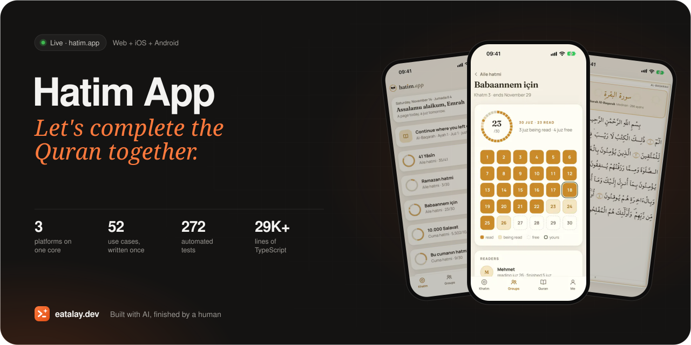
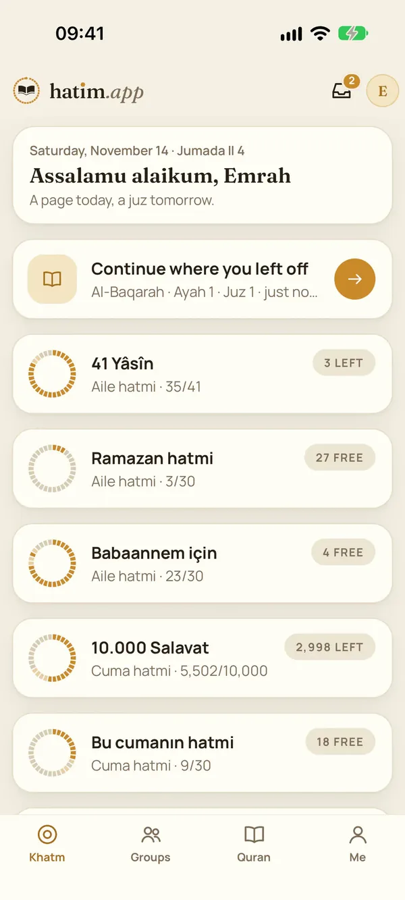
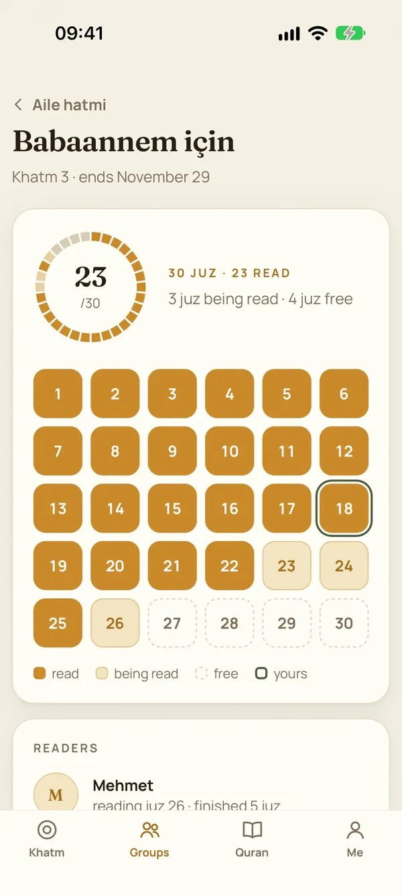
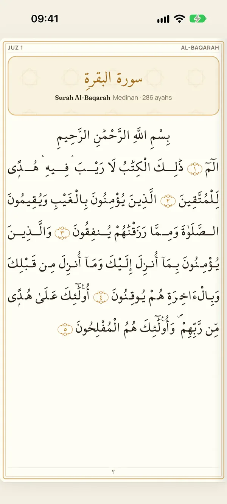
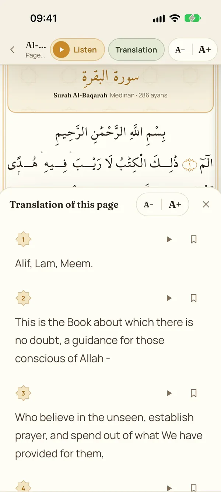
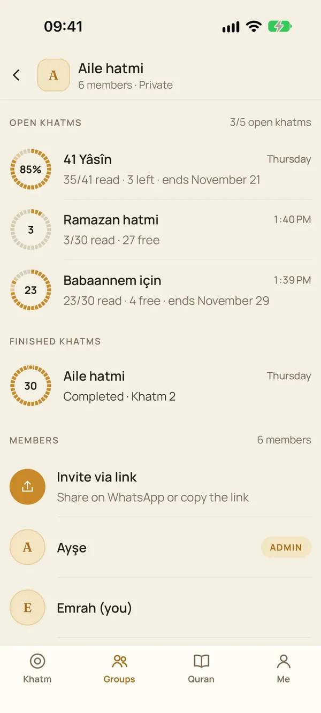
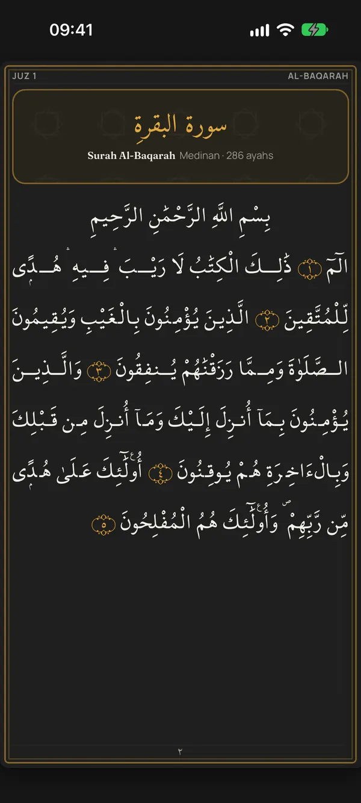

**Let's complete the Quran together.** Start a khatm group with your family, your friends or your mosque community. Everyone takes a juz and marks it once read; when the ring fills, the khatm is complete. Read the Quran like a book, listen to Alafasy, pick up where you left off.

> **Live and free at [hatim.app](https://hatim.app)** in English and Turkish. The iOS and Android apps run on the same core. This repository is a showcase; the source code is private. Read the full case study on **[eatalay.dev →](https://eatalay.dev/en/projects/hatim-app)**

<table>
  <tr>
    <td width="33%"></td>
    <td width="33%"></td>
    <td width="33%"></td>
  </tr>
  <tr>
    <td align="center">Today: where you left off.</td>
    <td align="center">Thirty juz, one screen.</td>
    <td align="center">A reader like a book.</td>
  </tr>
  <tr>
    <td></td>
    <td></td>
    <td></td>
  </tr>
  <tr>
    <td align="center">Translation and recitation per ayah.</td>
    <td align="center">Groups with a WhatsApp invite.</td>
    <td align="center">Dark theme for night reading.</td>
  </tr>
</table>

## The problem

A group khatm is an old and beautiful tradition: in a family, a mosque or a WhatsApp group, the 30 juz of the Quran are shared out. But the list of who took which juz, and who finished, is kept by hand and gets lost between messages.

Hatim App puts it on one screen. An admin opens a khatm, everyone taps a free juz to take it and taps "Read" when done. Every member's screen refreshes on its own. The bar was that a 60-year-old can use it without help: big buttons, plain language, and no account needed just to read.

## Two things that set it apart

**A reader like a book.** Ayahs follow the page layout of the Medina mushaf and the page folds from where your finger holds it, right to left like a real book, with a recorded page-turn sound that follows the leaf. Nine type sizes; the translation grows with them. The fold geometry and page fitting live in one shared engine that web and mobile both run.

**A group khatm that survives a double tap.** When two people tap the same juz at the same moment, it ends up with one owner. Pressing the same button twice changes nothing. The rule is a pure function in the shared core; the server backs it with row locks, conditional updates and idempotency keys, and race tests run against a real Postgres.

## What's inside

| Khatms | Reading | Community |
| --- | --- | --- |
| **Quran khatm:** 30 juz shared across the group | **Translation:** Sahih International (EN), Diyanet (TR) | **Public and private groups**, joined by request |
| **Surah khatm:** a target count with a share per member | **Alafasy recitation**, ayah by ayah, keeps playing with the screen locked | **WhatsApp invite:** tap the link, no codes |
| **Ayat al-Kursi:** a set number of recitations | **Offline:** text and translations ship inside the app | **Push notifications** and a daily reminder |
| **Dhikr:** salawat, istighfar, tasbih and more | **Where you left off** follows you across devices | **Read without an account** |

## Built like a product

| | |
| --- | --- |
| **3** platforms | Web, iOS and Android on one shared core |
| **50+** use cases | Each business rule is written once and used by all three |
| **272** automated tests | Including race tests on real Postgres |
| **29K+** lines | One TypeScript monorepo |

The website, the mobile app and the server share the same core package. Dependencies only point inward and lint rules guard the boundaries, so neither the UI nor the server rewrites a rule.

## How it was built

An AI agent team writes, tests and documents the code; I set the architecture, review every change and make the calls. The visual language follows religious sensitivities: only the 8-pointed star and geometric patterns, no figures of living beings.

---

Made by **Emrah Atalay** at <a href="https://eatalay.dev/en">eatalay.dev</a>: mobile apps, games and automation, built with AI and finished by a human. Have an app in mind? <a href="mailto:info@eatalay.dev">info@eatalay.dev</a>
